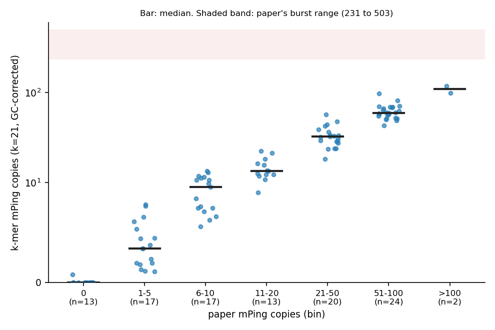
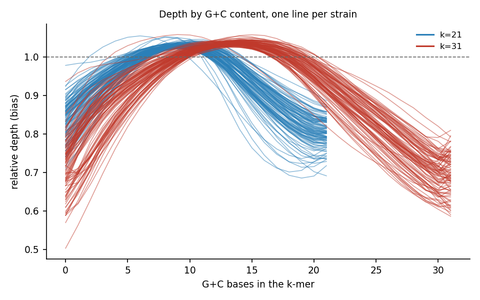
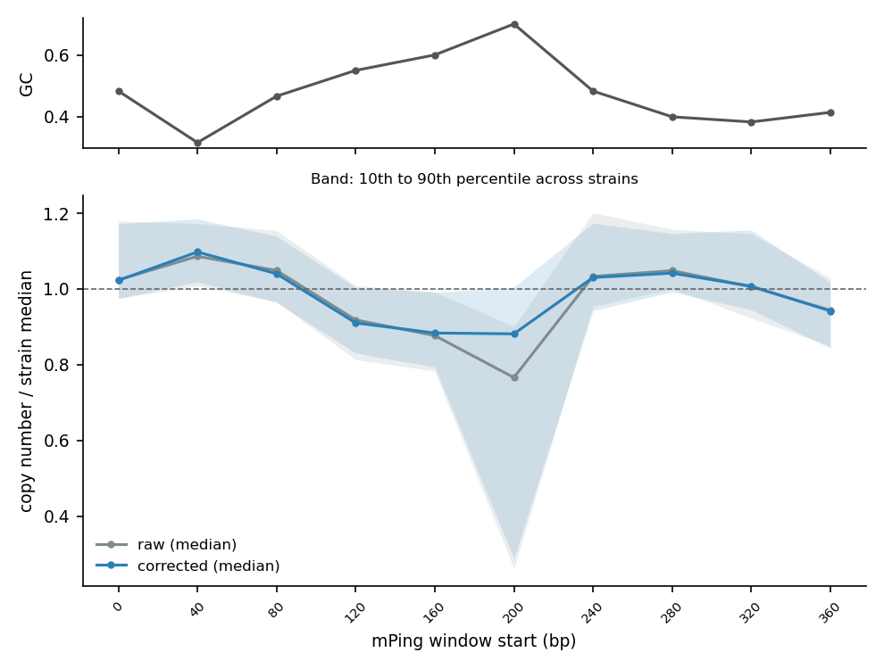
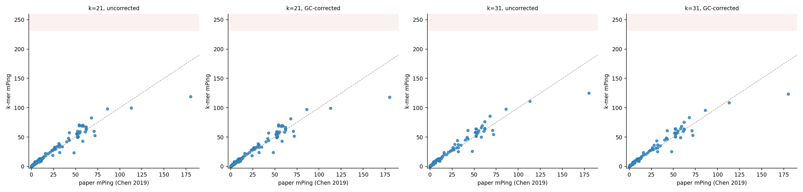
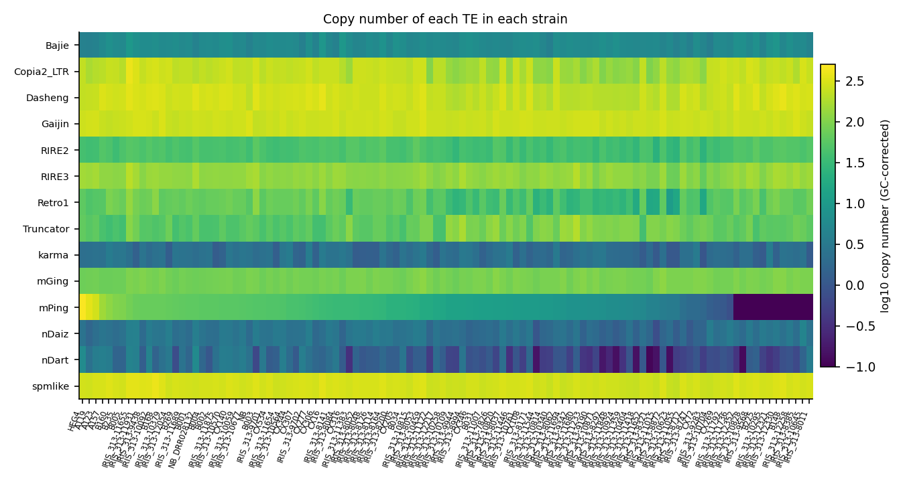
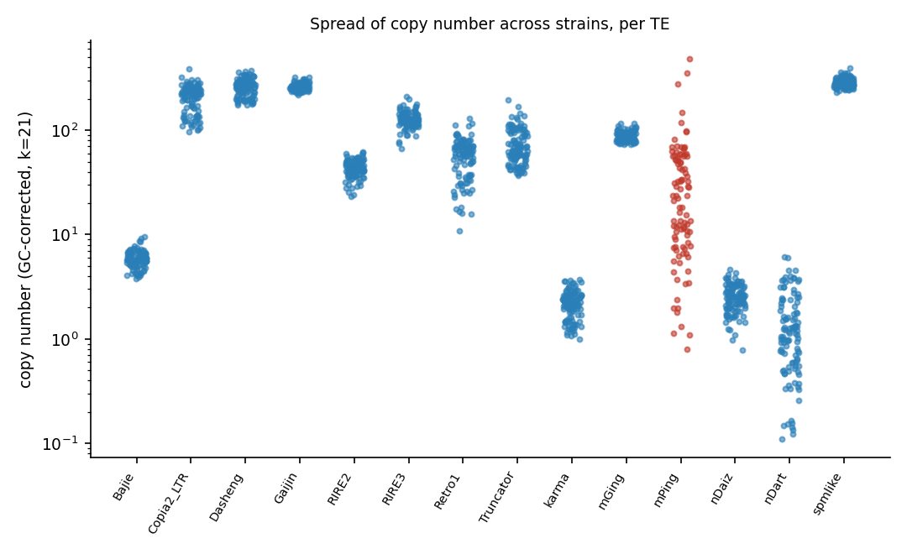

# TE copy numbers from k-mer depth: results

Generated 2026-10-26. This is the single current report. Earlier versions are in the git history.

## Summary

- mPing copy numbers from k-mer depth agree with the paper's read-depth values. For 106 strains at k=21 with GC correction, the rank correlation is 0.986 and the median ratio to the paper is 1.12.
- GC correction changes the median absolute error from 2.03 to 1.92 copies at k=21. The rank correlation changes from 0.985 to 0.986.
- On the 94 strains with both k values and a paper value, k=21 has median absolute error 2.02 copies and k=31 has 1.94. Spearman is 0.986 and 0.985. The difference is small. k=31 gives no baseline for more strains (17 against 5 at k=21).
- mPing and nDart vary most across strains. The other 12 TEs are recovered at similar copy numbers in all strains. For 4 TEs (mGing, RIRE2, Gaijin, RIRE3) k=21 and k=31 rank the strains differently.
- The dip near mPing base 200 is only partly explained by GC bias.

## Data

- Stratified 3K set: 100 accessions.
  - k=21: 95 have a copy number. 4 have no clear single-copy peak. No output: 1 (B191).
  - k=31: 84 have a copy number. 15 have no clear single-copy peak. No output: 1 (B191).

  - B191: NCBI has no full-format .sra for run ERR624821 (only an SRA Lite file), so the job stopped before counting. SRA Lite files have simplified quality scores.
- All strains in the analysis: k=21 110, k=31 95, counting only those with a baseline. 110 (k=21) and 95 (k=31) have a GC-bias curve. Strains without a curve are not corrected.
- A strain with no clear single-copy peak (no baseline) has no values. It is missing from the figures, not set to zero.

## mPing across the paper's range

| paper bin | strains | median estimate | median estimate / paper |
|---|---|---|---|
| 0 | 13 | 0 |  |
| 1-5 | 17 | 3.42 | 1.14 |
| 6-10 | 17 | 9.57 | 1.24 |
| 11-20 | 13 | 13.5 | 1.11 |
| 21-50 | 20 | 32.3 | 1.13 |
| 51-100 | 24 | 59.3 | 1.07 |
| >100 | 2 | 109 | 0.77 |

The 3K accessions were chosen at random within paper bins, not at random from the 3,000 lines, so overall rates need weighting by bin.

## Reference and burst strains

| strain | group | paper | k=21 corrected | k=31 corrected |
|---|---|---|---|---|
| HEG4 | burst |  | 481 | 477 |
| A119 | burst |  | 354 |  |
| A123 | burst |  | 277 |  |
| A157 | landrace_unverified |  | 148 |  |
| NB | reference | 52 | 52.3 | 52 |
| CX140 | reference | 52 | 56.5 | 57.1 |
| NB_DRR028132 | reference | 52 | 59.6 | 63.4 |

The paper gives a value only for Nipponbare. For the burst lines it gives only a range for the four bursting accessions (231 to 503). HEG4, A119 and A123 are three of them. A157 is a landrace expected to have high mPing, from the project notes. The paper does not list it.

## GC bias

Each line is one strain. A flat line at 1 means no bias. Lines that slope down at high G+C show lower depth
for G+C-rich k-mers. The correction divides each k-mer's depth by its strain's value for the k-mer's G+C count.
Count bins with fewer than 1,000 genome k-mers are not corrected.

## mPing along its sequence

Windows are 40 consecutive mPing k-mers (k=21). Only strains with at least 8 mPing copies are used. The lowest window is the one starting at base 200. Across the 74 strains with at least 8 mPing copies, its copy number is a median 0.77 of the strain median without correction and 0.88 with correction. The 10th percentile strain is at 0.26 without and 0.29 with correction. GC correction therefore removes part of the median dip, but the lowest-copy strains stay low. The cause of that remaining dip is not known from these data.

## mPing against the paper

| setting | n | pearson | spearman | median ratio to paper (paper > 0) | median abs error | max abs error |
|---|---|---|---|---|---|---|
| k21 uncorrected, all strains | 106 | 0.956 | 0.985 | 1.12 | 2.03 | 60.8 |
| k21 GC-corrected, all strains | 106 | 0.957 | 0.986 | 1.12 | 1.92 | 61.9 |
| k31 uncorrected, all strains | 94 | 0.961 | 0.985 | 1.13 | 2.06 | 55.2 |
| k31 GC-corrected, all strains | 94 | 0.961 | 0.985 | 1.12 | 1.94 | 56.4 |
| k21 uncorrected, shared strains | 94 | 0.958 | 0.986 | 1.12 | 2.06 | 60.8 |
| k21 GC-corrected, shared strains | 94 | 0.958 | 0.986 | 1.11 | 2.02 | 61.9 |
| k31 uncorrected, shared strains | 94 | 0.961 | 0.985 | 1.13 | 2.06 | 55.2 |
| k31 GC-corrected, shared strains | 94 | 0.961 | 0.985 | 1.12 | 1.94 | 56.4 |

Each row uses the paper's read-depth value (Chen et al. 2019) as the reference.
"Shared strains" restricts both k values to the strains that have both.

## Which k is better for mPing

On the 94 strains that have both k values and a paper value, the GC-corrected k=21 estimate has Spearman 0.986 and median absolute error 2.02 copies. The GC-corrected k=31 estimate has Spearman 0.985 and median absolute error 1.94 copies. k=31 has the smaller error, and the difference is small (0.09 copies). mPing has 410 unique k-mers at k=21 and 400 at k=31, so specificity does not separate the two values of k for mPing.

## All TEs in the library

The library has 14 TEs. The paper gives values only for mPing (and for Ping and Pong, which are not in
`RiceTE.fa`). For the other 13 TEs there is no reference value, so their copy numbers can only be checked
for internal consistency:

- **Agreement between k values** (`rho k=21 vs k=31`). A TE with a stable copy number should agree
  between k=21 and k=31.
- **Dependence on depth** (`rho vs depth`). A copy number that rises or falls with the strain's single-copy
  depth may reflect an artifact.

| TE | median k=21 | q90/q10 k=21 | log10 SD k=21 | rho vs depth k=21 | median k=31 | median k=31 / k=21 | rho k=21 vs k=31 |
|---|---|---|---|---|---|---|---|
| Bajie | 5.82 | 1.61 | 0.08 | -0.08 | 1.93 | 0.33 | 0.65 |
| Copia2_LTR | 225 | 2.24 | 0.14 | -0.05 | 179 | 0.8 | 0.94 |
| Dasheng | 268 | 1.69 | 0.08 | -0.1 | 126 | 0.47 | 0.88 |
| Gaijin | 258 | 1.19 | 0.03 | -0.38 | 65.7 | 0.25 | 0.46 |
| RIRE2 | 42.8 | 1.58 | 0.08 | -0.3 | 6.94 | 0.16 | 0.18 |
| RIRE3 | 124 | 1.51 | 0.08 | -0.24 | 66.5 | 0.54 | 0.53 |
| Retro1 | 62.2 | 3.13 | 0.21 | 0.05 | 20.9 | 0.34 | 0.9 |
| Truncator | 64.4 | 2.52 | 0.16 | -0.37 | 21.6 | 0.34 | 0.95 |
| karma | 2.28 | 2.34 | 0.14 | 0.12 | 2.08 | 0.91 | 0.98 |
| mGing | 90 | 1.3 | 0.04 | -0.52 | 6.9 | 0.08 | 0.11 |
| mPing | 23 | 18.9 | 0.56 | 0.29 | 23.5 | 1.02 | 1 |
| nDaiz | 2.48 | 2.17 | 0.14 | -0.15 | 1.44 | 0.58 | 0.9 |
| nDart | 1.16 | 10.8 | 0.4 | 0.19 | 0.99 | 0.86 | 0.99 |
| spmlike | 288 | 1.27 | 0.04 | -0.17 | 173 | 0.6 | 0.75 |

### Findings

- **Which TEs vary between strains.** mPing and nDart vary most (log10 SD 0.56 and 0.40). The other 12 TEs have log10 SD from 0.03 to 0.21. For them, the 90th percentile strain is 1.2 to 3.1 times the 10th percentile strain. These TEs are recovered at similar copy numbers across strains. There is no published per-strain value for them, so this shows consistency across strains, not accuracy.
- **k=21 against k=31.** For mPing the two agree (rank correlation 1.00, median ratio 1.02). For 4 TEs the rank correlation is below 0.6: mGing (0.11), RIRE2 (0.18), Gaijin (0.46), RIRE3 (0.53). For most TEs the k=31 median is lower than the k=21 median (ratio 0.08 to 1.02). Because there is no reference value for these TEs, these data do not say which k is right for them. One explanation to test is that diverged copies lose exact 31-base matches more often than 21-base matches. mPing copies are near-identical, which fits its agreement.
- **Dependence on depth.** At k=21 the copy number falls as single-copy depth rises for mGing (-0.52), Gaijin (-0.38), Truncator (-0.37). A rank correlation of this size can come from the baseline estimate or from real differences between strains. These data do not separate the two.

## Limits

- The 100-accession set was sampled within paper bins, so these results are not a population estimate.
- Strains in the figures are the ones with both a baseline and a GC curve, unless the table says otherwise.
- The paper's values come from read depth. They are independent of k-mer depth, but they are only available for mPing.
- The correction assumes the bias is a function of G+C content alone. Other sequence features are not corrected.
