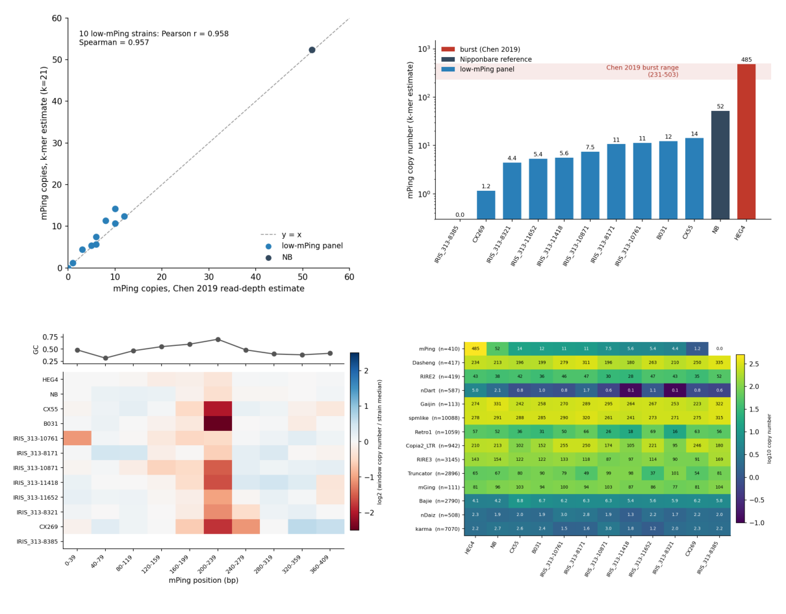
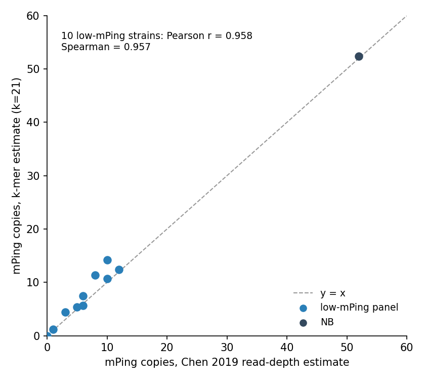
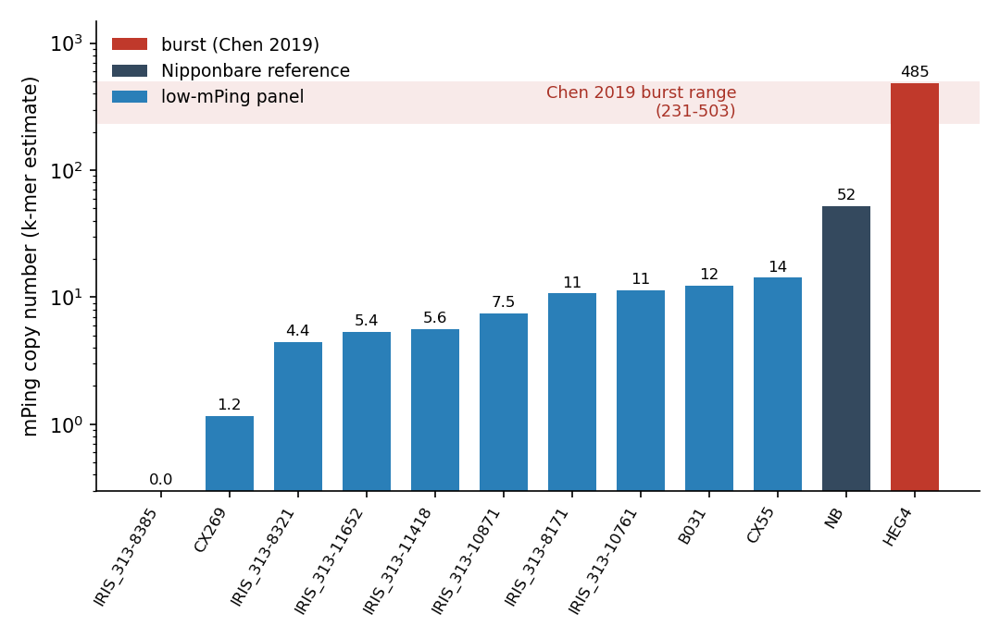
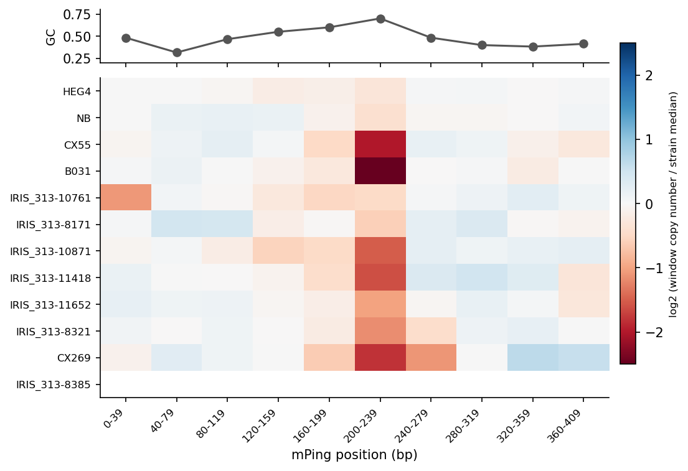
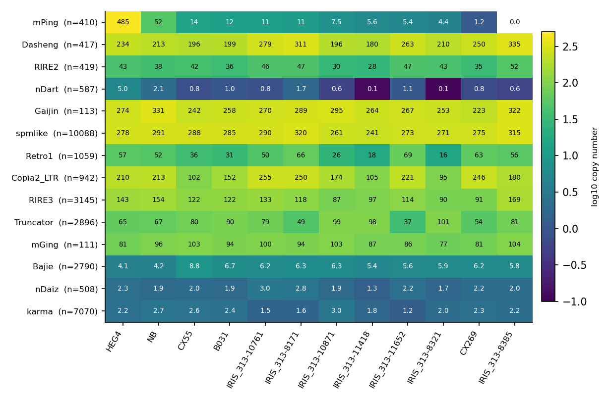

# mPing k-mer screen: preliminary results

*Click the image for the [PDF](REPORT.pdf). Generated 2026-10-23 from code at commit 3aafa2a (uncommitted changes present).*

Copy numbers of rice transposable elements (TEs) estimated from k-mer depth in short reads, compared with
published values. The algorithm is described in [`docs/ALGORITHM.md`](../ALGORITHM.md).

**Scope.** k=21; 12 strains; 14 TEs in `RiceTE.fa`; no GC correction applied.

## Summary

- For the 10 low-mPing strains, the k-mer mPing estimate and the Chen et al. 2019 read-depth estimate
  have Pearson r = 0.958 and Spearman 0.957. The k-mer value is a median 1.17 times the paper's
  (range 0.94 to 1.48).
- Nipponbare (NB) gives 52.4 mPing copies. The paper lists 52 for its Nipponbare entry.
- HEG4 gives 485. The paper reports 231 to 503 for its four bursting accessions and no value for HEG4 alone.

## Figure 1. mPing copies against the paper

{width=60%}

With 10 points, the correlation is a small-sample result.

## Figure 2. mPing copies by strain

{width=85%}

The low-mPing panel spans 0 to 14 copies, NB has 52 and HEG4 has 485.
Fold change against NB understates how low the panel is, because NB carries 52 copies.
The HEG4 value has no independent check.

| strain | group | single_copy_depth | paper_mPing | kmer_mPing_k21 | ratio |
|---|---|---|---|---|---|
| HEG4 | burst | 133 |  | 484.6 |  |
| NB | reference | 57 | 52 | 52.4 | 1.01 |
| CX55 | low_panel | 5 | 10 | 14.2 | 1.42 |
| B031 | low_panel | 8 | 12 | 12.4 | 1.03 |
| IRIS_313-10761 | low_panel | 6 | 8 | 11.3 | 1.42 |
| IRIS_313-8171 | low_panel | 7 | 10 | 10.7 | 1.07 |
| IRIS_313-10871 | low_panel | 12 | 6 | 7.5 | 1.25 |
| IRIS_313-11418 | low_panel | 8 | 6 | 5.6 | 0.94 |
| IRIS_313-11652 | low_panel | 17 | 5 | 5.4 | 1.07 |
| IRIS_313-8321 | low_panel | 9 | 3 | 4.4 | 1.48 |
| CX269 | low_panel | 12 | 1 | 1.2 | 1.17 |
| IRIS_313-8385 | low_panel | 5 | 0 | 0.0 |  |

## Figure 3. Position profile along mPing

{width=85%}

Windows are 40 consecutive unique k-mers. The window at positions 200 to 239 is the highest-GC stretch
of mPing (GC 0.70, against 0.47 for the whole element).
Several strains show a dip in this window. The lowest window is below 0.4 of the strain median in
B031 (0.17), IRIS_313-11418 (0.33), CX55 (0.25), CX269 (0.29), IRIS_313-10871 (0.35). A dip shared across strains at the highest-GC window suggests a
sequencing bias. This has not been tested. The GC correction is implemented in `scripts/mitekmer.py` and has not yet
been applied to these results. A strain with no mPing k-mers has an empty row.

## Figure 4. All TEs in the library

{width=90%}

For the TEs other than mPing and nDart, the largest-to-smallest ratio across strains ranges from 1.3 to 4.2.
For mPing the ratio is about 415 (485 against 1.2, leaving out strains with 0 copies).
nDart: 5.0 in HEG4 against 0.1 to 2.1 elsewhere.
There are no published copy numbers for these TEs in the data used here, so the remaining spread cannot be assigned to biology or noise.
`n` is the number of unique k-mers per TE.

## Limits

- Each strain is scaled by its own single-copy depth, taken as the highest peak above the error valley of its k-mer histogram.
  Low-depth strains (single-copy depth 5 to 9) sit close to that valley, so their scaling is less certain.
- A k-mer must match exactly, so diverged copies are undercounted.
- See [`docs/ALGORITHM.md`](../ALGORITHM.md) for the full list.

## Not yet included

- GC-corrected copy numbers.
- k=31 results for the same strains.
- Landraces A119, A123, A157 and a second Nipponbare dataset (DRR028132).
- 100 additional lines from the 3,000-genome set.
