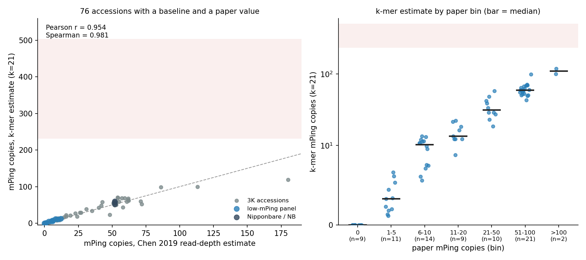

# mPing k-mer estimates across the stratified 3K set: successful accessions

Generated 2026-10-26 from the analysis outputs in `results/success/` (k=21 and k=31, complete: 14 TEs, all strains).

Figure. Left: k-mer mPing copy number (k=21) against the Chen et al. 2019 read-depth estimate, for 76 accessions. Right: the same estimates grouped by the paper's value. Bars show medians. The shaded band is the paper's burst range (231 to 503 copies).

## What succeeded

The 100-accession stratified set was streamed from ENA. The stream and counting ran as a SLURM array. Each accession gave one of three results:

| Result | k=21 | k=31 |
|---|---|---|
| Strains analysed | 84 | 78 |
| Baseline found, mPing estimate computed | 80 | 67 |
| No baseline (no clear single-copy peak), no estimate | 4 | 11 |
| Plotted (estimate and paper value both present) | 76 | 66 |

The analysed strains are 68 (k=21) or 65 (k=31) stream accessions, plus 16 or 13 earlier strains. The earlier strains are NB, HEG4, the 10 low-mPing panel strains, NB_DRR028132 and the landraces A119, A123 and A157. A157 has no k=31 run. Earlier strains without a paper value are in the table but not plotted.

Failed array tasks wrote no tables. Their accessions are not in these counts. The failures came from two causes:

- A read stream stopped with exit status 141 or 13. The cause was not logged. Peak memory was 20 to 26 GB against a 48 GB request, so memory alone does not explain it.
- The GC-bias step stopped on accessions with no baseline. Those accessions already had complete depth tables, so the failure did not affect the k-mer estimates. The step has not been changed yet, so the same failure will recur on a rerun.

## Findings

- **Ranking across the range.** The Spearman correlation is 0.981 at k=21 and 0.978 at k=31. The Pearson correlation is 0.954 and 0.959. Most accessions have low copy numbers, so Pearson is dominated by a few high values. The rank correlation is the more useful statistic here.
- **Bias by bin.** The median ratio of k-mer estimate to paper value is 1.08 to 1.23 in every bin from 1 to 100 copies at k=21. At k=31 it is 1.05 to 1.27. The two accessions above 100 copies have ratios of 0.77 (k=21) and 0.84 (k=31). Both are based on n=2.
- **Burst range.** No plotted accession reaches the burst range. The highest plotted estimate is for B160, with a paper value of 180: 119 copies at k=21 and 125 at k=31. HEG4 (485), A119 (360) and A123 (276) fall in the burst range, but the paper gives no per-line values for them, so they are not plotted.
- **k=21 and k=31.** Both give the same ranking. k=31 has more accessions with no baseline (11 against 4), so k=21 gives more usable estimates on this set.

## Limits

- The 100 accessions were chosen at random within mPing bins, not at random from the 3,000 lines. Bin sizes in the set do not match the population. Overall rates cannot be estimated from this sample without weighting by bin.
- The paper's values come from read depth in 14x data. Our values come from streamed reads of 10x to 30x. Depth differences could add bias. The bias by bin above shows the size of this effect, not its cause.
- Each estimate uses the single-copy depth from the k-mer histogram. A strain with no clear peak has no estimate. Those strains are missing from the figure, not set to zero.
- The GC correction has not been applied to these estimates.
- The burst lines are not plotted with a paper value, because the paper does not give one per line.

## Files

- `success_k21.png`, `success_k31.png`: figures
- `success_k21.tsv`, `success_k31.tsv`: per-accession values (paper value, k-mer estimate, single-copy depth)
- Source data: `results/success/k21/`, `results/success/k31/` (not tracked by git)
- Generated by `scripts/make_success_figure.py`
